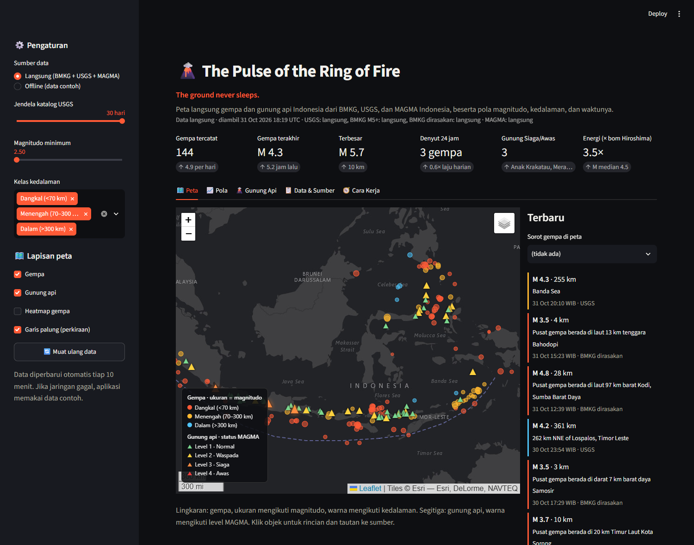
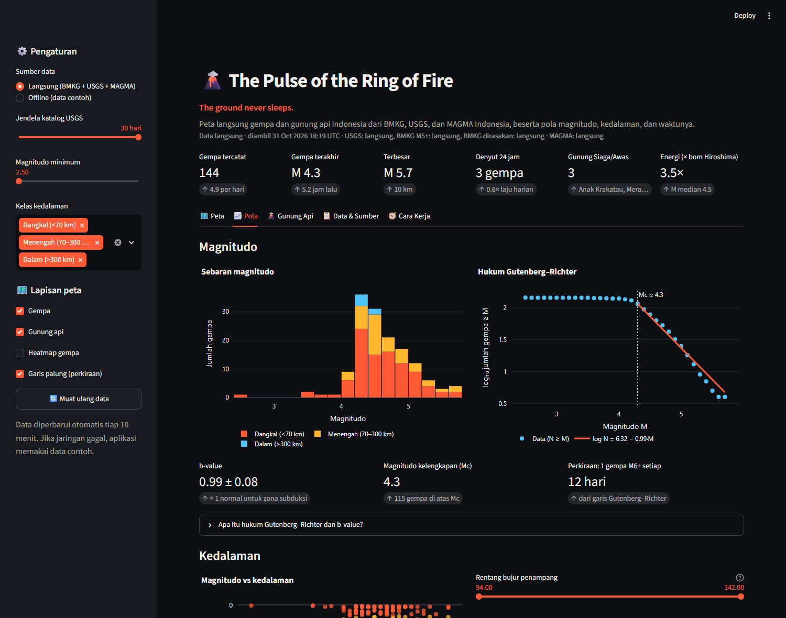
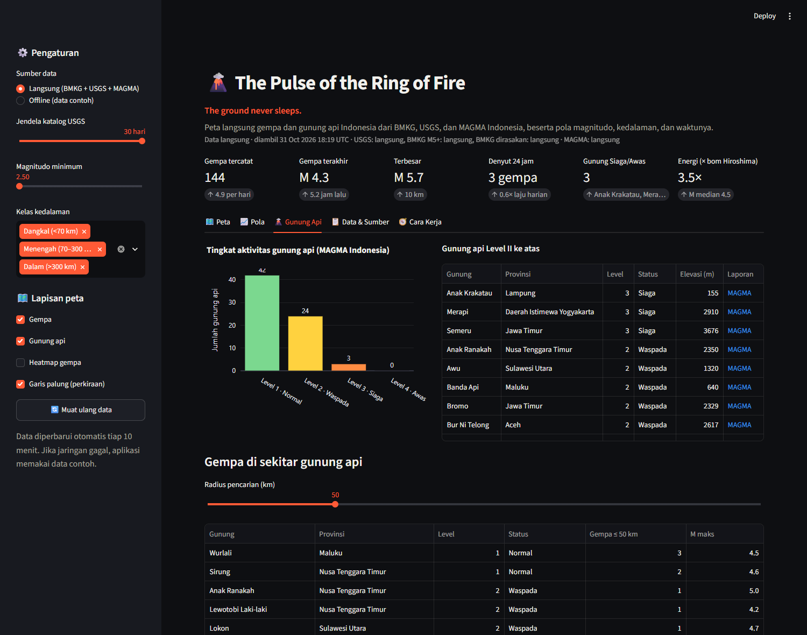
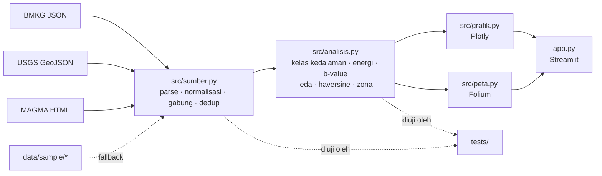

# 🌋 The Pulse of the Ring of Fire

> **The ground never sleeps.**
> Peta langsung gempa bumi dan gunung api Indonesia dari umpan publik **BMKG**, **USGS**, dan **MAGMA Indonesia**,
> dilengkapi analisis pola magnitudo, kedalaman, dan waktu. Dibangun dengan Python, pandas, Streamlit, Folium, dan Plotly.

*A live map of Indonesia's earthquakes and volcanoes, fed by public BMKG, USGS and MAGMA Indonesia data, with
magnitude, depth and time pattern analysis. Falls back to a cached sample dataset when offline.*

**🚀 Coba langsung di browser:** [ring-of-fire-pulse.streamlit.app](https://ring-of-fire-pulse.streamlit.app)



> ⚠️ **Disclaimer.** Aplikasi ini menampilkan ulang data publik untuk tujuan edukasi dan portofolio. Ia **bukan sistem
> peringatan dini**, tidak berafiliasi dengan BMKG, PVMBG/Badan Geologi, atau USGS, dan tidak boleh dipakai untuk
> keputusan keselamatan. Rujuk selalu ke [bmkg.go.id](https://www.bmkg.go.id/), [magma.esdm.go.id](https://magma.esdm.go.id/),
> dan [earthquake.usgs.gov](https://earthquake.usgs.gov/).

## Latar belakang

Indonesia duduk di pertemuan tiga lempeng besar dan memiliki gunung api aktif terbanyak di dunia. Setiap beberapa jam,
di suatu tempat di nusantara, bumi bergetar. Umpan datanya tersedia untuk umum, tetapi tersebar di tiga lembaga dengan
tiga format berbeda: JSON BMKG, GeoJSON USGS, dan halaman HTML MAGMA. Proyek ini menyatukannya dalam satu peta,
menghapus catatan ganda, lalu bertanya: adakah pola di balik denyut itu?

## Fitur

| Tab | Isi |
|---|---|
| 🗺️ Peta | Peta Folium gelap: gempa sebagai lingkaran (ukuran = magnitudo, warna = kedalaman), 69 gunung api sebagai segitiga berwarna level MAGMA, heatmap, garis palung, daftar 12 gempa terbaru dengan tombol sorot |
| 📈 Pola | Histogram magnitudo, hukum Gutenberg–Richter dengan **b-value** dan magnitudo kelengkapan, magnitudo vs kedalaman, penampang bujur × kedalaman (zona Wadati–Benioff), gempa per hari dan per jam, jeda antar gempa, energi kumulatif setara bom Hiroshima, zona 2°×2° paling ramai |
| 🌋 Gunung Api | Jumlah gunung api per level (Normal–Awas), tabel Level II ke atas dengan tautan laporan MAGMA, dan gempa dalam radius tertentu dari tiap gunung |
| 📋 Data & Sumber | Seluruh tabel dengan gunung api terdekat, unduh CSV, tabel sumber, catatan pengambilan data |
| 🧭 Cara Kerja | Alur data dari umpan ke peta |

Kartu KPI di atas: jumlah gempa, gempa terakhir, gempa terbesar, **denyut 24 jam** (laju gempa sehari terakhir
dibanding laju rata-rata), gunung api Siaga/Awas, dan total energi yang dilepas.




## Cara menjalankan

```bash
git clone https://github.com/Avalon2222/ring-of-fire-pulse.git
cd ring-of-fire-pulse
python -m venv .venv && source .venv/bin/activate   # Windows: .venv\Scripts\activate
pip install -r requirements.txt
streamlit run app.py
```

Buka `http://localhost:8501`. Data diambil saat aplikasi dibuka dan disimpan 10 menit; tombol "Muat ulang data"
di sidebar memaksa pengambilan baru. Jika jaringan tidak tersedia, aplikasi otomatis memakai data contoh di
`data/sample/` dan menampilkan spanduk peringatan. Mode offline juga bisa dipilih langsung di sidebar.

Pengujian: `python -m pytest tests/ -v` (27 tes, tanpa jaringan). Perbarui data contoh:
`python scripts/perbarui_sample.py`.

## Sumber data

| Sumber | Isi | Format |
|---|---|---|
| [BMKG](https://data.bmkg.go.id/) | 15 gempa M5+ terkini dan 15 gempa dirasakan terakhir | JSON |
| [USGS FDSN Event API](https://earthquake.usgs.gov/fdsnws/event/1/) | Katalog gempa 30 hari, M ≥ 2,5, kotak 12°LS–7°LU / 94°–142°BT | GeoJSON |
| [MAGMA Indonesia](https://magma.esdm.go.id/v1/gunung-api/tingkat-aktivitas) (PVMBG) | Tingkat aktivitas 69 gunung api, Level I–IV | HTML |
| [Smithsonian GVP](https://volcano.si.edu/) | Koordinat dan elevasi gunung api (`data/gunung_api.csv`) | CSV statis |

Rincian metodologi, termasuk cara deduplikasi lintas sumber dan rumus yang dipakai, ada di
[`data/SUMBER_DATA.md`](data/SUMBER_DATA.md).

## Cara kerja (ringkas)



Beberapa rumus inti:

- **Energi**: `log10 E[J] = 1,5 M + 4,8`; satu magnitudo naik berarti energi 32 kali lipat.
- **Gutenberg–Richter**: `log10 N(≥M) = a − b·M`, dengan `b` ditaksir cara Aki (1965) dari gempa di atas magnitudo kelengkapan.
- **Jarak**: haversine, dihitung sekaligus untuk semua pasangan gempa–gunung api dengan broadcasting numpy.

## Struktur proyek

```
ring-of-fire-pulse/
├── app.py                 # antarmuka Streamlit
├── src/
│   ├── sumber.py          # pengambilan, parser, gabung, fallback offline
│   ├── analisis.py        # pola magnitudo, kedalaman, waktu, ruang
│   ├── grafik.py          # grafik Plotly
│   └── peta.py            # peta Folium
├── data/
│   ├── gunung_api.csv     # 69 gunung api: koordinat, elevasi, provinsi
│   ├── sample/            # salinan umpan untuk mode offline dan pengujian
│   └── SUMBER_DATA.md     # sumber dan metodologi
├── scripts/perbarui_sample.py
├── tests/                 # 27 tes pytest, tanpa jaringan
└── docs/
    ├── BELAJAR.md         # panduan belajar
    ├── LATIHAN.md         # latihan bertingkat
    └── screenshots/
```

## Belajar dari proyek ini

- [`docs/BELAJAR.md`](docs/BELAJAR.md): panduan dari nol, mulai dari mengapa Indonesia bergetar, membaca tiga format umpan,
  deduplikasi, energi dan b-value, broadcasting numpy, sampai model mental Streamlit. Sekitar 3–4 jam.
- [`docs/LATIHAN.md`](docs/LATIHAN.md): sembilan latihan dari menambah satu baris CSV hingga deteksi kawanan gempa dan
  katalog SQLite, masing-masing dengan petunjuk dan kunci.

## Keterbatasan

- Jenis magnitudo antar lembaga (mb, mww, ml, skala BMKG) dicampur begitu saja; untuk gempa kecil selisihnya bisa 0,3.
- Deduplikasi memakai jendela 2 menit dan setengah derajat, sehingga gempa susulan yang sangat rapat bisa tergabung.
- b-value dari jendela 30 hari bersifat kasar; nilainya untuk memahami bentuk hukumnya, bukan untuk prakiraan.
- Garis palung digambar tangan sebagai orientasi, bukan data batas lempeng resmi.
- Halaman MAGMA dibaca dengan ekspresi reguler; perubahan tata letak situs akan membuat bagian itu jatuh ke data contoh.

## Lisensi

Kode berlisensi MIT. Data milik lembaga masing-masing dan tunduk pada ketentuan penggunaannya.
