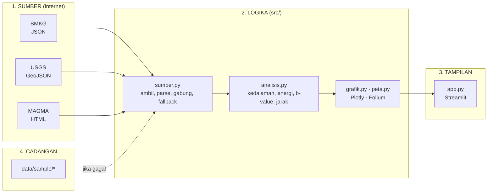

# 🎓 Panduan Belajar: Membaca Denyut Bumi dengan Python

Panduan ini untuk pembaca yang sudah bisa menjalankan skrip Python sederhana tetapi belum pernah mengolah data
gempa, memanggil API, atau membuat peta. Tujuannya bukan menghafal kode, melainkan memahami **mengapa** kodenya
ditulis begitu. Bacalah sambil membuka berkas yang disebut, dan ubah sesuatu di setiap bagian. Jika rusak,
`git checkout -- .` mengembalikan semuanya.

Perkiraan waktu: 3–4 jam, boleh dibagi beberapa sesi.

---

## Bab 0 — Mengapa Indonesia?

Indonesia duduk di pertemuan tiga lempeng besar: Indo-Australia yang menunjam ke bawah Eurasia di sepanjang
Palung Sunda, dan Pasifik yang mendesak dari timur. Hasilnya: sekitar 10.000 gempa tercatat setiap tahun dan
127 gunung api aktif, terbanyak di dunia. Lingkaran ini, dari Sumatra melingkar lewat Jawa, Nusa Tenggara,
Maluku, Sulawesi Utara sampai Filipina dan Jepang, dinamai **Cincin Api Pasifik**.

Aplikasi ini menangkap "denyut" itu: setiap beberapa jam, di suatu tempat di Indonesia, bumi bergetar.
Pertanyaan yang ingin dijawab:

1. Di mana gempa terjadi, seberapa besar, seberapa dalam?
2. Apakah ada pola? Jam tertentu? Hari tertentu? Tempat tertentu?
3. Gunung api mana yang sedang gelisah, dan adakah gempa di dekatnya?



**Mengapa dipisah empat?** Supaya setiap bagian bisa diuji dan diganti sendiri-sendiri. `analisis.py` tidak tahu
Streamlit ada; ia hanya menerima tabel dan mengembalikan angka. Itulah yang membuatnya mudah diuji oleh `pytest`.

---

## Bab 1 — Mengambil data dari internet (`src/sumber.py`)

### 1.1 Tiga sumber, tiga bentuk

Buka `src/sumber.py` dan lihat tiga konstanta `URL_*`. Ketiganya bisa dibuka di browser:

- **BMKG** memberi JSON rapi: `{"Infogempa": {"gempa": [ {...}, {...} ]}}`. Tetapi nilainya teks semua:
  `"Magnitude": "5.3"`, `"Kedalaman": "10 km"`, `"Coordinates": "-4.40,132.49"`.
- **USGS** memberi GeoJSON, standar peta: tiap gempa adalah `Feature` dengan `geometry.coordinates`
  `[bujur, lintang, kedalaman]`. Perhatikan urutannya: **bujur dulu**, bukan lintang. Ini sumber bug klasik.
- **MAGMA** tidak menyediakan API publik, hanya halaman HTML. Kita "membaca" tabelnya dengan ekspresi reguler.

### 1.2 Mengubah teks menjadi angka

```python
def _angka(teks):
    cocok = re.search(r"-?\d+(?:[.,]\d+)?", str(teks))
    return float(cocok.group(0).replace(",", ".")) if cocok else None
```

Fungsi kecil ini mengambil angka pertama dari `"10 km"` → `10.0` dan toleran terhadap koma desimal. Cobalah di
terminal Python: `from src.sumber import _angka; _angka("Kedalaman 120,5 km")`.

### 1.3 Satu bentuk untuk semua

Setiap parser mengembalikan DataFrame dengan **kolom yang sama** (`KOLOM_GEMPA`): `id, waktu_utc, lat, lon,
magnitudo, kedalaman_km, wilayah, sumber, keterangan, url`. Setelah titik ini, tidak ada lagi kode yang perlu
tahu apakah sebuah baris datang dari BMKG atau USGS. Ini disebut *normalisasi*, dan hampir semua proyek data
dimulai dari sini.

### 1.4 Waktu: selalu UTC di dalam, WIB di luar

Semua waktu disimpan dengan zona UTC (`pd.to_datetime(..., utc=True)`) dan baru diubah ke WIB di `analisis.tambah_kolom`.
Aturan praktis: **simpan UTC, tampilkan lokal**. Jika suatu saat aplikasi dipakai untuk WITA atau WIT, hanya satu
konstanta yang berubah.

### 1.5 Dua lembaga, satu gempa: deduplikasi

Gempa M5,3 di Laut Banda dicatat USGS pukul 20:32:13 di (-4,40; 132,49) dan oleh BMKG pukul 20:32:20 di
(-4,47; 132,49). Dua baris, satu kejadian. `gabung_gempa` menyelesaikannya dengan cara kasar tetapi efektif:
bulatkan waktu ke jendela 2 menit dan koordinat ke setengah derajat, lalu buang duplikat dengan `drop_duplicates`.
Baris USGS diurutkan lebih dulu sehingga ia yang dipertahankan.

Pikirkan: kapan cara ini salah? (Jawaban: dua gempa berbeda yang terjadi dalam 2 menit dan 50 km, misalnya
gempa susulan. Lihat Latihan 7.)

### 1.6 Jika internet mati

`muat_semua` membungkus tiap pengambilan dalam `try/except`. Sumber yang gagal dicatat di `kesalahan`, dan jika
semua katalog gempa kosong, berkas di `data/sample/` dipakai. Aplikasi lalu memasang spanduk kuning. Prinsipnya:
**gagal dengan jelas, bukan diam-diam**. Pengguna harus tahu bahwa yang dilihatnya bukan data langsung.

---

## Bab 2 — Mencari pola (`src/analisis.py`)

### 2.1 Tiga kelas kedalaman

Seismologi membagi gempa menjadi dangkal (< 70 km), menengah (70–300 km), dan dalam (> 300 km). Gempa dangkal
paling berbahaya karena energinya mencapai permukaan tanpa banyak teredam. Gempa dalam hanya mungkin terjadi di
dalam lempeng yang menunjam, karena batuan di luar lempeng pada kedalaman itu sudah terlalu panas untuk patah.
Jadi, peta gempa dalam adalah peta lempeng yang tenggelam.

### 2.2 Energi: mengapa M6 bukan "dua kali" M3

```python
def energi_joule(m):
    return 10 ** (1.5 * m + 4.8)
```

Skala magnitudo logaritmik. Naik satu angka berarti energi naik `10^1.5 ≈ 32` kali. Naik dua angka berarti
1.000 kali. Satu gempa M6 melepaskan energi yang kira-kira sama dengan satu bom Hiroshima, dan satu M7 setara
tiga puluh dua bom. Grafik "energi kumulatif" di aplikasi hampir selalu berbentuk tangga: datar lama, lalu
melompat ketika satu gempa besar terjadi. Ribuan gempa kecil hampir tidak terlihat di sana.

### 2.3 Hukum Gutenberg–Richter dan b-value

Jika kita hitung berapa gempa dengan magnitudo **≥ M** untuk tiap M, lalu plot `log10 N` terhadap M, hasilnya
garis lurus menurun: `log10 N = a − b·M`. Ini berlaku di seluruh dunia, dan `b` hampir selalu di sekitar 1,
artinya tiap kenaikan satu magnitudo, jumlah gempa turun sepuluh kali.

Dua jebakan:

1. **Magnitudo kelengkapan (Mc).** Di bawah magnitudo tertentu, jaringan seismometer melewatkan banyak gempa, sehingga
   kurva melengkung di kiri. `b` hanya boleh dihitung dari gempa di atas Mc. Kode menaksir Mc sebagai bin dengan
   jumlah gempa terbanyak (metode kelengkungan maksimum).
2. **Jangan memakai regresi linear biasa** pada titik-titik log, karena titik di ujung kanan (gempa besar, sedikit)
   terlalu berisik. Aki (1965) menunjukkan penaksir yang jauh lebih stabil:

   ```python
   b = math.log10(math.e) / (rata_rata_M - (Mc - lebar_bin / 2))
   ```

   Koreksi `lebar_bin / 2` ada karena magnitudo dibulatkan ke 0,1.

Lihat `tests/test_analisis.py::test_b_value_mendekati_satu_untuk_data_sintetis`: katalog buatan dibangkitkan dari
sebaran eksponensial dengan `b = 1`, lalu diuji apakah fungsi mengembalikan ≈ 1. Begitulah cara menguji rumus
statistik: buat data yang jawabannya diketahui.

### 2.4 Waktu: bumi tidak mengenal siang dan malam

`per_jam` menghitung gempa per jam WIB. Hasilnya hampir selalu rata. Ini pelajaran penting tentang **pola
semu**: dengan 150 gempa dibagi 24 jam, rata-rata 6 per jam, variasi acak saja akan membuat satu jam tampak
"ramai" dengan 12 gempa dan jam lain "sepi" dengan 2. Sebelum menyimpulkan ada pola, tanyakan: apakah ini lebih
besar dari yang diharapkan dari kebetulan?

`jeda_antar_gempa` menghitung selisih waktu antara gempa berurutan. Jika gempa terjadi secara acak dan saling
bebas (proses Poisson), jeda mengikuti sebaran eksponensial: banyak jeda pendek, sedikit jeda panjang. Kawanan
gempa dan gempa susulan menyimpang dari ini, dengan jeda pendek yang jauh lebih banyak.

### 2.5 Ruang: haversine dan kotak

Jarak dua titik di permukaan bola:

```python
a = sin²(Δlat/2) + cos(lat1)·cos(lat2)·sin²(Δlon/2)
jarak = 2R·asin(√a)          # R = 6.371 km
```

`gunung_terdekat` menghitung jarak **semua gempa ke semua gunung api** sekaligus dengan *broadcasting* numpy:
`lat_gempa[:, None]` berukuran (N,1), `lat_gunung[None, :]` berukuran (1,69), hasilnya matriks (N,69). Lalu
`argmin(axis=1)` memilih kolom terkecil per baris. Tanpa satu pun `for`. Dengan 150 gempa itu tidak penting,
dengan 150.000 gempa itu bedanya menit versus detik.

`zona_aktif` membagi peta ke kotak 2°×2° (sekitar 220 km) dengan pembagian bulat `lat // 2 * 2`, lalu
`groupby`. Ini bentuk paling sederhana dari *spatial binning*; versi canggihnya memakai H3 atau DBSCAN.

---

## Bab 3 — Menggambar (`src/peta.py`, `src/grafik.py`)

### 3.1 Folium: Python yang menulis JavaScript

Folium membungkus Leaflet.js. Setiap `folium.CircleMarker(...)` menjadi beberapa baris JavaScript saat peta
dirender. Konsekuensinya: 500 marker ringan, 50.000 marker membuat browser berat. Pilihan desain di sini:

- **Ukuran lingkaran = magnitudo**, dengan `radius = M² / 4,5`. Kuadrat, bukan linear, supaya M6 jelas lebih
  mencolok dari M4 (kesan visual manusia terhadap luas, bukan jari-jari).
- **Warna = kedalaman**, bukan magnitudo, karena ukuran sudah mewakili magnitudo. Dua variabel, dua saluran visual.
- **Gunung api = segitiga** lewat `DivIcon` (HTML `&#9650;`), diwarnai sesuai level MAGMA, dan diberi cahaya
  (`text-shadow`) untuk Level III–IV.
- `FeatureGroup` + `LayerControl` memberi tombol mata/sembunyikan untuk tiap lapisan.
- Legenda adalah potongan HTML yang ditempel ke peta lewat `MacroElement`; Folium tidak punya legenda bawaan.

### 3.2 Plotly: satu fungsi, satu grafik

Setiap fungsi di `grafik.py` mengembalikan `go.Figure`, dan `_rapikan` menyeragamkan tema gelap, margin, dan
legenda. Pola ini membuat `app.py` tetap pendek: `st.plotly_chart(grafik.histogram_magnitudo(gempa))`.

Perhatikan `penampang_subduksi`: sumbu x bujur, sumbu y kedalaman yang dibalik (`autorange="reversed"`), ukuran
titik magnitudo. Persempit bujur ke 100–115 di aplikasi dan Anda akan melihat pita gempa yang semakin dalam ke
arah utara: lempeng Indo-Australia yang menunjam di bawah Sumatra dan Jawa. Diagram ini, zona Wadati–Benioff,
adalah salah satu bukti awal teori lempeng tektonik pada 1960-an.

---

## Bab 4 — Merangkai di Streamlit (`app.py`)

### 4.1 Model mental Streamlit

Streamlit menjalankan ulang **seluruh** `app.py` dari atas setiap kali pengguna menyentuh widget apa pun. Itu
sebabnya kode terlihat seperti skrip biasa, dan itu sebabnya `@st.cache_data(ttl=600)` penting: tanpa cache, tiap
klik slider memanggil BMKG, USGS, dan MAGMA lagi. Dengan cache, hasil `muat_semua` disimpan 10 menit dan
dibagikan ke semua pengguna.

### 4.2 Filter murah, muat mahal

Perhatikan bahwa `muat()` selalu dipanggil dengan `magnitudo_min=2.5`, dan slider magnitudo hanya memfilter
DataFrame di memori. Jika slider dimasukkan ke parameter cache, tiap perubahan slider menjadi kunci cache baru
dan memicu pengambilan data lagi. Aturan: **ambil data selebar mungkin sekali, saring di memori sesering apa pun.**

### 4.3 `st_folium` dan `returned_objects=[]`

`st_folium` secara bawaan mengirim balik kejadian klik, zoom, dan posisi ke Python, yang memicu rerun. Untuk
peta yang hanya dilihat, `returned_objects=[]` mematikan itu dan membuat aplikasi jauh lebih responsif.

---

## Bab 5 — Pengujian (`tests/`)

Dua berkas, 27 tes, tidak satu pun menyentuh internet:

- `test_sumber.py` memberi JSON/HTML kecil buatan ke parser dan memeriksa hasilnya. Ada juga tes yang
  **mematikan jaringan** dengan `monkeypatch` lalu memastikan aplikasi jatuh ke data contoh.
- `test_analisis.py` memberi data sintetis dengan jawaban yang diketahui (b = 1, jarak Jakarta–Surabaya ≈ 660
  km, gempa 3 km dari Merapi harus terdekat ke Merapi).

Jalankan `python -m pytest tests/ -v`. Saat Anda mengubah sesuatu di `src/`, inilah jaring pengaman Anda.

---

## Bab 6 — Ke mana selanjutnya

- Tambahkan sumber lain: GFZ GEOFON (`geofon.gfz-potsdam.de/fdsnws/event/1/`) memakai API FDSN yang sama dengan USGS.
- Simpan katalog harian ke SQLite agar jendela tidak terbatas 30 hari, lalu hitung b-value per bulan.
- Deteksi kawanan: cari pasangan gempa dalam 50 km dan 24 jam, bangun graf, hitung komponen terhubung.
- Peringatan sederhana: jika ada M ≥ 6 dalam 1 jam terakhir, tampilkan spanduk merah (dan ingat, ini tetap bukan
  sistem peringatan resmi).

Latihan terarah ada di `LATIHAN.md`.
